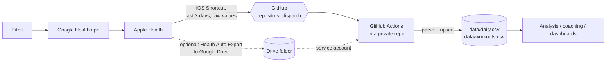

# health-pipeline

Incremental ETL that turns wearable data into one tidy row per day, event-driven from the phone, with no server and no paid export app.



**Extract** payloads pushed by an iOS Shortcut (or export files from Drive) → **transform** them into a fixed daily schema with normalised units → **load** with keyed upserts into CSV, committed to a private repository.

## Why it is built this way

| Decision | Reason |
|---|---|
| Read from Apple Health, not the Fitbit cloud | The legacy Fitbit Web API was shut down on 2 Nov 2026. Its replacement, the Google Health API, classifies every health scope as *restricted*: production access needs a security review, and an unreviewed personal app's refresh tokens expire after 7 days, which breaks unattended jobs. The data already flows Fitbit → Google Health → Apple Health on the phone, so the pipeline taps the end of that chain. |
| iOS Shortcut → `repository_dispatch` as the primary hand-off | Shortcuts can read Apple Health and POST JSON natively, so no third-party export app is needed. The dispatch event starts the workflow immediately; a fine-grained token scoped to the one private repo is the only credential. |
| A dumb Shortcut and a smart parser | Shortcuts are hard to test and version. The phone only sends raw values for the last 3 days as strings; day bucketing, sleep-stage overlap merging, night assignment and Turkish/English number formats (`10.234`, `30,1`) are handled in Python with tests. |
| Triggered on app open, not on a clock | iOS encrypts Health data while the phone is locked, so a time-of-day automation silently fails. Triggering on "first app opened in the morning" guarantees an unlocked device. |
| Google Drive + **service account** (optional route) | The phone app can write to Drive on a schedule. A service account reads the shared folder without user OAuth, so nothing expires and nobody has to sign in again. Scope is `drive.readonly`. |
| GitHub Actions as the scheduler | Free, managed cron with secrets storage and an audit trail. Each run is a commit, so the data has full history and diffs. |
| **Incremental** runs | `state/sync_state.json` records each source file's version (Drive `modifiedTime`, or a content hash for local files). Unchanged files are skipped, so a run downloads only what is new. |
| **Idempotent, column-level upserts** | Rows are keyed by `date` (workouts by `start`). A record only overwrites the columns it carries, so a late export that only revises sleep does not wipe that day's steps. Values are rounded before comparison, so re-running over the same input produces a byte-identical file and no commit. |
| Overlapping 3-day window | Sleep and HRV are often finalised hours after waking. Each export re-sends the last 3 days; the upsert picks up the revised values and leaves everything else untouched. |
| Code public, data private | This repo holds only code and synthetic fixtures. Real data lives in a separate private repo whose workflow installs this package. Logs print counts and dates, never metric values. |
| Tolerant parsers | Health Auto Export's schema has changed between versions (sleep and workout field names). Known variants are mapped; unknown metrics are ignored instead of failing the run; one corrupt file does not block the rest. |

## Data model

`data/daily.csv`, one row per date:

| Group | Columns |
|---|---|
| Sleep (minutes, night ending on `date`) | `sleep_min`, `sleep_deep_min`, `sleep_rem_min`, `sleep_core_min`, `sleep_awake_min`, `in_bed_min`, `sleep_start`, `sleep_end` |
| Heart | `hrv_ms`, `resting_hr_bpm`, `hr_min_bpm`, `hr_avg_bpm`, `hr_max_bpm`, `walking_hr_bpm`, `vo2max` |
| Recovery signals | `resp_rate_bpm`, `spo2_pct`, `wrist_temp_c` |
| Activity | `steps`, `active_kcal`, `basal_kcal`, `distance_km`, `exercise_min`, `flights` |
| Body | `weight_kg`, `body_fat_pct`, `lean_mass_kg`, `bmi` |

`data/workouts.csv`: `start`, `date`, `name`, `end`, `duration_min`, `distance_km`, `active_kcal`, `hr_avg_bpm`, `hr_max_bpm`.

Units are normalised on the way in: kJ → kcal, miles/metres → km, lb → kg, °F → °C, SpO₂ fractions → percent, hours → minutes.

## Setup (Shortcut route)

1. **Token.** GitHub → Settings → Developer settings → Fine-grained tokens → *Generate*. Repository access: only the private data repo. Permissions: **Contents: Read and write**. Copy the token.
2. **Data repo.** Copy [`examples/data-repo-sync.yml`](examples/data-repo-sync.yml) to `.github/workflows/sync.yml` in the private repo.
3. **Shortcut.** Build a Shortcut that, for each metric, runs *Find Health Samples* (last 3 days, grouped by day), formats each result as `YYYY-MM-DD=value`, joins them with `;`, and finally calls *Get Contents of URL*:
   - `POST https://api.github.com/repos/<owner>/<data-repo>/dispatches`
   - Headers: `Authorization: Bearer <token>`, `Accept: application/vnd.github+json`
   - JSON body: `{"event_type": "health", "client_payload": {"source": "shortcut", "metrics": {"steps": "...", "hrv_ms": "...", ...}, "sleep": "...", "workouts": "..."}}` (GitHub caps `client_payload` at 10 top-level keys, so metrics are nested).
   - Building 18 near-identical blocks by hand is error-prone, so [`tools/build_shortcut.py`](tools/build_shortcut.py) generates the whole Shortcut (128 actions) from a small hand-built reference: it clones the reference's own action dictionaries, so parameter shapes match what the Shortcuts app actually writes. Sign it on a Mac with `shortcuts sign -i Saglik_unsigned.shortcut -o Saglik.shortcut` and open it.
   - Sleep is sent as raw segments `start|end|stage;...`, workouts as `start|end|name|kcal|km;...`, timestamps formatted `yyyy-MM-dd'T'HH:mm`.
   - Payload format is documented in [`parse_shortcut.py`](src/health_pipeline/parse_shortcut.py).
4. **Automation.** Shortcuts → Automation → *App* → "is opened" (an app you open every morning) → *Run Immediately*.

## Setup (optional Drive route)

1. **Phone.** [Health Auto Export](https://apps.apple.com/app/id1115567069) automation: destination Google Drive, Health Metrics (+ Workouts), daily aggregation, last 3 days, JSON.
2. **Google Cloud.** Enable the **Google Drive API**, create a **service account** and a JSON key, share the Drive folder with the service account as *Viewer*.
3. **Secrets** in the data repo: `GDRIVE_SA_KEY` (the whole JSON key) and `GDRIVE_FOLDER_ID`.

Backfill (either route): commit an export file to the data repo's `inbox/`; the next run merges it.

## Local use

```bash
pip install -e ".[dev,drive]"
pytest -q
health-pipeline sync --inbox ./inbox --data-dir ./data --state ./state/sync_state.json
# with Drive
export GDRIVE_SA_KEY="$(cat key.json)" GDRIVE_FOLDER_ID=...
health-pipeline sync --data-dir ./data --state ./state/sync_state.json
```

## Layout

```
src/health_pipeline/
  parse_shortcut.py iOS Shortcut payload -> {date: {column: value}} (sleep segments, locale numbers)
  parse_hae.py      Health Auto Export JSON -> {date: {column: value}}, workouts
  store.py          keyed CSV upserts with a change report
  sync.py           incremental run: sources -> parse -> store -> state
  sources/drive.py  Google Drive via service account (recursive, oldest first)
  sources/local.py  local inbox folder
  cli.py            `health-pipeline sync`
tools/build_shortcut.py  generates the iOS Shortcut from a hand-built reference (clone, don't guess)
tests/              synthetic fixtures: Shortcut payload (Turkish locale) and both Health Auto Export schemas
```

## License

MIT
