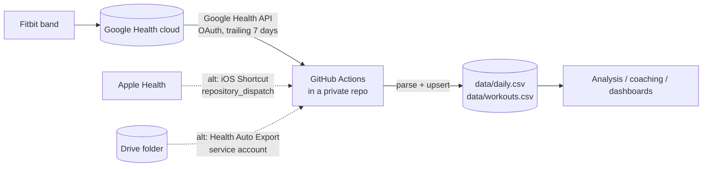

# health-pipeline

Incremental ETL that turns wearable data into one tidy row per day, on a schedule, with no server, no phone in the loop and no paid export app.



**Extract** from the Google Health API (or, alternatively, payloads pushed by an iOS Shortcut / export files on Drive) → **transform** into a fixed daily schema with normalised units → **load** with keyed upserts into CSV, committed to a private repository three times a day.

## Why it is built this way

| Decision | Reason |
|---|---|
| Read from the **Google Health API**, at the source | The device writes to Google's cloud first. Google Health only mirrors a subset into Apple Health: HRV and skin temperature never make it there. Reading the API gets every metric, exactly as the Fitbit app shows it. |
| OAuth **installed-app flow** with PKCE, run once on a laptop | [`tools/google_login.py`](tools/google_login.py) (stdlib only) opens the consent page, catches the redirect on `127.0.0.1`, stores the refresh token with mode `600`, and probes every data type, saving raw responses so the parser could be written against real payloads instead of guessed ones. The refresh token, client id and secret go into one Actions secret. |
| Fail loudly on auth, softly on data | Google Health scopes are *restricted*. If the token is revoked or expires, the job fails with a clear message, so GitHub's failure e-mail is the "log in again" reminder. A single data type failing (missing scope, transient 5xx) is reported and skipped; the other types still land. 429/5xx are retried with backoff. |
| **Trailing window**, not cursors | Sleep, HRV and skin temperature are finalised hours after waking, and the phone syncs whenever it likes. Every run re-reads the last 7 days (backfill: any number) and the upsert keeps only real changes, so there is no cursor to corrupt and late data always arrives. |
| Respect API limits by construction | Daily roll-ups are requested in ≤14-day chunks (the limit for heart rate and calories); session lists page at 25. A 90-day backfill is ~70 calls. |
| GitHub Actions as the scheduler | Free, managed cron with secrets storage and an audit trail. Each run is a commit, so the data has full history and diffs. |
| **Idempotent, column-level upserts** | Rows are keyed by `date` (workouts by `start`). A record only overwrites the columns it carries. Values are rounded before comparison, so re-running over the same input produces a byte-identical file and no commit. |
| Code public, data private | This repo holds only code and synthetic fixtures. Real data lives in a separate private repo whose workflow installs this package. Logs print counts and dates, never metric values or tokens. |
| Pluggable sources | API sources (`fetch()` a window) and file sources (incremental by file version) feed the same tables, so the Shortcut and Drive routes below still work as alternatives. |

## Data model

`data/daily.csv`, one row per date:

| Group | Columns |
|---|---|
| Sleep (minutes, main sleep ending on `date`) | `sleep_min`, `sleep_deep_min`, `sleep_rem_min`, `sleep_core_min`, `sleep_awake_min`, `in_bed_min`, `sleep_start`, `sleep_end` |
| Heart | `hrv_ms`, `resting_hr_bpm`, `sleep_hr_bpm`, `hr_min_bpm`, `hr_avg_bpm`, `hr_max_bpm`, `walking_hr_bpm`, `vo2max` |
| Recovery signals | `resp_rate_bpm`, `spo2_pct`, `wrist_temp_c`, `skin_temp_delta_c` (nightly minus personal baseline) |
| Activity | `steps`, `active_kcal`, `basal_kcal`, `total_kcal`, `distance_km`, `exercise_min`, `active_zone_min`, `flights` |
| Body | `weight_kg`, `body_fat_pct`, `lean_mass_kg`, `bmi` |

`data/workouts.csv`: `start`, `date`, `name`, `end`, `duration_min`, `distance_km`, `active_kcal`, `total_kcal`, `steps`, `hr_avg_bpm`, `hr_max_bpm`.

Google Health API mapping: `daily-*` types give HRV (and non-REM sleeping heart rate), resting HR, SpO₂, respiratory rate, VO₂ max and nightly skin temperature; `sleep` sessions give stages; daily roll-ups give steps, distance, floors, active/total calories, active-zone minutes (cardio/peak count double, as in the Fitbit app), moderate+vigorous minutes and min/avg/max heart rate; `exercise` sessions become workouts. Times are converted to the local offset stored with each record.

Units are normalised on the way in: mm → km, g → kg, kJ → kcal, miles → km, lb → kg, °F → °C, SpO₂ fractions → percent, hours → minutes.

## Setup (Google Health API)

1. **Google Cloud.** Enable the **Google Health API**. OAuth consent screen: External; add the scopes `googlehealth.activity_and_fitness.readonly`, `googlehealth.health_metrics_and_measurements.readonly`, `googlehealth.sleep.readonly`; add your account as a test user. Create an OAuth client of type **Desktop app** and download its JSON.
2. **Log in once** on your computer: `python3 tools/google_login.py` (finds the newest `~/Downloads/client_secret_*.json`). It also writes raw sample responses to `~/Projects/google-probe/` for inspection.
3. **Secret.** In the private data repo add `GOOGLE_HEALTH_CREDS` = `{"client_id": "...", "client_secret": "...", "refresh_token": "..."}`.
4. **Workflow.** Copy [`examples/data-repo-sync.yml`](examples/data-repo-sync.yml) to `.github/workflows/sync.yml` in the private repo. Run it once by hand with a larger `days` value to backfill.

While the OAuth app is in *Testing* status Google expires refresh tokens after 7 days; repeat step 2–3 when the job reports an expired token.

## Alternative routes

**iOS Shortcut → `repository_dispatch`.** A Shortcut reads Apple Health and POSTs the last 3 days to `https://api.github.com/repos/<owner>/<data-repo>/dispatches` with a fine-grained token (Contents: read/write on the data repo only). Payload format: [`parse_shortcut.py`](src/health_pipeline/parse_shortcut.py). [`tools/build_shortcut.py`](tools/build_shortcut.py) generates the whole Shortcut (128 actions) by cloning a small hand-built reference, so parameter shapes match what the Shortcuts app writes; sign it on a Mac with `shortcuts sign`. Caveats learned the hard way: Health type names must be Apple's internal identifiers, *Find Health Samples* aborts the Shortcut on an empty result (no try/catch), and Health data is unreadable while the phone is locked.

**Health Auto Export → Google Drive.** The app writes daily JSON to a Drive folder; a service account (`drive.readonly`) reads it. Secrets: `GDRIVE_SA_KEY`, `GDRIVE_FOLDER_ID`. Files are processed incrementally by Drive `modifiedTime`.

## Local use

```bash
pip install -e ".[dev]"
pytest -q
export GOOGLE_HEALTH_CREDS='{"client_id": "...", "client_secret": "...", "refresh_token": "..."}'
health-pipeline sync --google --google-days 30 --data-dir ./data --state ./state/sync_state.json
# file routes
health-pipeline sync --inbox ./inbox --data-dir ./data --state ./state/sync_state.json
```

## Layout

```
src/health_pipeline/
  sources/google_health.py  Google Health API client (token refresh, paging, chunked roll-ups) + parser
  sources/drive.py          Google Drive via service account (recursive, oldest first)
  sources/local.py          local inbox folder
  parse_shortcut.py         iOS Shortcut payload -> {date: {column: value}}
  parse_hae.py              Health Auto Export JSON -> {date: {column: value}}, workouts
  store.py                  keyed CSV upserts with a change report
  sync.py                   one run: API + file sources -> parse -> store -> state
  cli.py                    `health-pipeline sync`
tools/google_login.py       one-time OAuth login + data probe (stdlib, runs on macOS system python)
tools/build_shortcut.py     generates the iOS Shortcut from a hand-built reference
tests/                      synthetic fixtures for every source; fake HTTP server for the API client
```

## License

MIT
