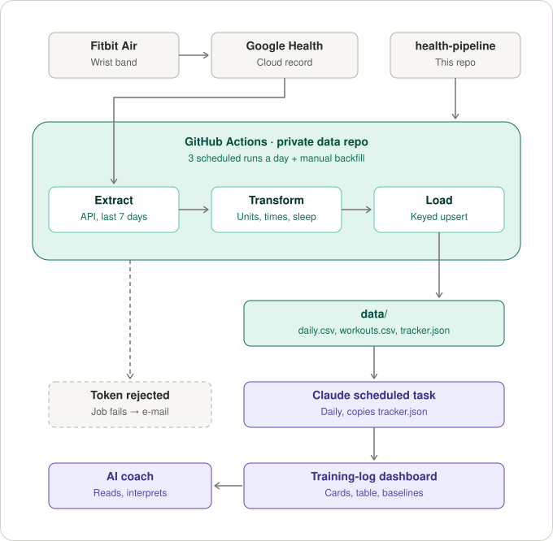
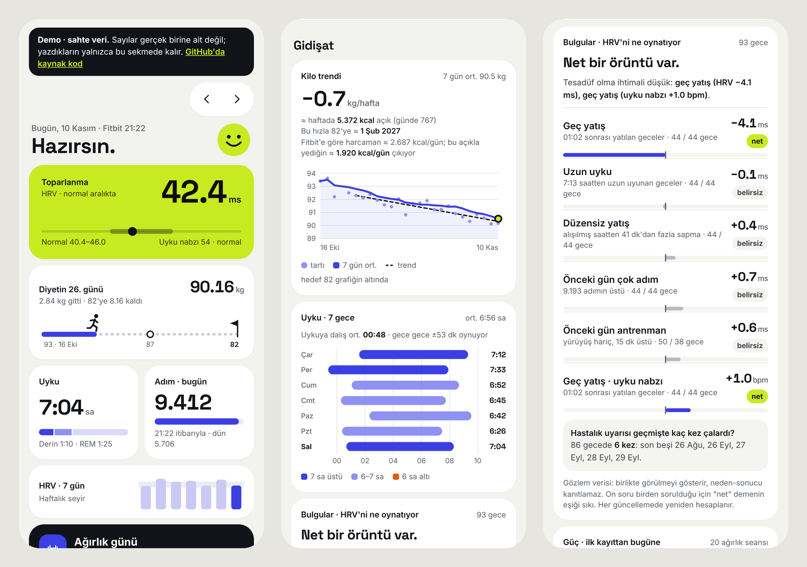

# health-pipeline

Incremental ETL and analysis for wearable health data. It extracts Fitbit metrics from the Google Health API, normalises them into a typed daily schema, maintains versioned CSV tables through idempotent upserts on a GitHub Actions schedule, and then tests which habits actually move overnight recovery.

**[Live demo of the dashboard](https://nonentertainer.github.io/health-pipeline/)** · synthetic data, runs in the browser, nothing to install.



## Highlights

- **Source-of-truth extraction.** OAuth 2.0 with PKCE, token refresh, pagination, chunked daily roll-ups and retry with backoff against the Google Health API. Metrics that never reach Apple Health, such as HRV and nightly skin temperature, are included.
- **Idempotent loads.** Column-level upserts keyed by date, with values rounded before comparison: re-running the same window produces a byte-identical file and no commit.
- **Late data handled by design.** Each run re-reads a trailing 7-day window instead of keeping a cursor, so values Fitbit finalises hours later are picked up and there is no state to corrupt.
- **Failure isolation.** One failing data type is reported and skipped while the rest still load; a rejected token fails the job loudly so the owner is notified.
- **No infrastructure to run.** GitHub Actions is the scheduler and git is the audit log: every data change is a reviewable diff.
- **Privacy split.** Public code, private data repository; logs carry counts and dates, never metric values or credentials.
- **Analysis that refuses to over-claim.** An [insights step](#insights) asks whether bedtime, sleep length, steps or training go together with a better night, using detrended outcomes, rank correlation, permutation p-values and a false-discovery correction across every question asked. When the data cannot answer yet, it says so and estimates how many more nights it needs.
- **A dashboard you can try.** The [live demo](https://nonentertainer.github.io/health-pipeline/) is the production page, unchanged, running against an in-memory database filled with synthetic data that went through the real pipeline code. See [Dashboard and live demo](#dashboard-and-live-demo).
- **Tested.** 78 tests on synthetic fixtures, including a fake HTTP layer for the API client, planted-effect data for the statistics, and a check that the published demo matches its generator.

In my deployment the private data repository also builds `data/insights.json` and `data/tracker.json` after every run, and a Claude scheduled task loads them into a training-log dashboard used for coaching. An iOS Shortcut source and a Drive-export source are implemented as alternative inputs into the same tables.

## Why it is built this way

| Decision | Reason |
|---|---|
| Read from the **Google Health API**, at the source | The device writes to Google's cloud first. Google Health only mirrors a subset into Apple Health: HRV and skin temperature never make it there. Reading the API gets every metric, exactly as the Fitbit app shows it. |
| OAuth **installed-app flow** with PKCE, run once on a laptop | [`tools/google_login.py`](tools/google_login.py) (stdlib only) opens the consent page, catches the redirect on `127.0.0.1`, stores the refresh token with mode `600`, and probes every data type, saving raw responses so the parser could be written against real payloads instead of guessed ones. The refresh token, client id and secret go into one Actions secret. |
| Fail loudly on auth, softly on data | Google Health scopes are *restricted*. If the token is revoked or expires, the job fails with a clear message, so GitHub's failure e-mail is the "log in again" reminder. A single data type failing (missing scope, transient 5xx) is reported and skipped; the other types still land. 429/5xx are retried with backoff. |
| **Trailing window**, not cursors | Sleep, HRV and skin temperature are finalised hours after waking, and the phone syncs whenever it likes. Every run re-reads the last 7 days (backfill: any number) and the upsert keeps only real changes, so there is no cursor to corrupt and late data always arrives. |
| Respect API limits by construction | Daily roll-ups are requested in ≤14-day chunks (the limit for heart rate and calories); session lists page at 25. A 90-day backfill is ~70 calls. |
| GitHub Actions as the scheduler | Free, managed cron with secrets storage and an audit trail. Each run is a commit, so the data has full history and diffs. |
| **Idempotent, column-level upserts** | Rows are keyed by `date` (workouts by `start`). A record only overwrites the columns it carries. Values are rounded before comparison, so re-running over the same input produces a byte-identical file and no commit. |
| Code public, data private | This repo holds only code and synthetic fixtures. Real data lives in a separate private repo whose workflow installs this package. Logs print counts and dates, never metric values or tokens. |
| Pluggable sources | API sources (`fetch()` a window) and file sources (incremental by file version) feed the same tables, so the Shortcut and Drive routes below still work as alternatives. |

## Data model

`data/daily.csv`, one row per date:

| Group | Columns |
|---|---|
| Sleep (minutes, the night ending on `date`: split sessions merged, daytime naps left out) | `sleep_min`, `sleep_deep_min`, `sleep_rem_min`, `sleep_core_min`, `sleep_awake_min`, `in_bed_min`, `sleep_start`, `sleep_end` |
| Heart | `hrv_ms`, `resting_hr_bpm`, `sleep_hr_bpm`, `hr_min_bpm`, `hr_avg_bpm`, `hr_max_bpm`, `walking_hr_bpm`, `vo2max` |
| Recovery signals | `resp_rate_bpm`, `spo2_pct`, `wrist_temp_c`, `skin_temp_delta_c` (nightly minus personal baseline) |
| Activity | `steps`, `active_kcal`, `basal_kcal`, `total_kcal`, `distance_km`, `exercise_min`, `active_zone_min`, `flights` |
| Body | `weight_kg`, `body_fat_pct`, `lean_mass_kg`, `bmi` |

`data/workouts.csv`: `start`, `date`, `name`, `end`, `duration_min`, `distance_km`, `active_kcal`, `total_kcal`, `steps`, `hr_avg_bpm`, `hr_max_bpm`.

Google Health API mapping: `daily-*` types give HRV (and non-REM sleeping heart rate), resting HR, SpO₂, respiratory rate, VO₂ max and nightly skin temperature; `sleep` sessions give stages; daily roll-ups give steps, distance, floors, active/total calories, active-zone minutes (cardio/peak count double, as in the Fitbit app), moderate+vigorous minutes and min/avg/max heart rate; `exercise` sessions become workouts. Times are converted to the local offset stored with each record.

Units are normalised on the way in: mm → km, g → kg, kJ → kcal, miles → km, lb → kg, °F → °C, SpO₂ fractions → percent, hours → minutes.

## Setup (Google Health API)

1. **Google Cloud.** Enable the **Google Health API**. OAuth consent screen: External; add the scopes `googlehealth.activity_and_fitness.readonly`, `googlehealth.health_metrics_and_measurements.readonly`, `googlehealth.sleep.readonly`; add your account as a test user. Create an OAuth client of type **Desktop app** and download its JSON.
2. **Log in once** on your computer: `python3 tools/google_login.py` (finds the newest `~/Downloads/client_secret_*.json`). It also writes raw sample responses to `~/Projects/google-probe/` for inspection.
3. **Secret.** In the private data repo add `GOOGLE_HEALTH_CREDS` = `{"client_id": "...", "client_secret": "...", "refresh_token": "..."}`.
4. **Workflow.** Copy [`examples/data-repo-sync.yml`](examples/data-repo-sync.yml) to `.github/workflows/sync.yml` in the private repo. Run it once by hand with a larger `days` value to backfill.

While the OAuth app is in *Testing* status Google expires refresh tokens after 7 days; repeat step 2–3 when the job reports an expired token.

## Insights

```bash
health-pipeline insights --data-dir data --out data/insights.json --md data/insights.md
```

Collecting numbers is the easy half. The tempting half is reading causes into them: one good night after an early bedtime feels like proof. This step exists to stop that. It reads the same tables the sync maintains and answers two questions, with the standard library only.

**1. Which habits go together with a better night?** Five habits (bedtime, sleep length, steps the day before, training the day before, how far bedtime strayed from the recent usual) are each tested against two outcomes (HRV, sleeping heart rate).

| Step | Why |
|---|---|
| Detrend each outcome: the night's value minus the median of the previous 14 nights | HRV drifts over weeks with fitness and weight. Without this, any habit that drifted over the same weeks would look like a cause. |
| Spearman rank correlation | One freak night cannot carry the result, and no straight-line relationship is assumed. |
| Permutation p-value (10,000 shuffles, fixed seed) | No distributional assumptions; with a fixed seed an unchanged table gives a byte-identical file. |
| Benjamini-Hochberg across all ten tests | Asking ten questions of 40 nights will "find" something by chance. The verdict (`clear` q < 0.05, `likely` q < 0.20, otherwise `unclear`) is based on the corrected value. |
| Effect in the outcome's own unit, from a median split | "3 ms lower HRV on nights after 01:06" is something a person can weigh; a correlation coefficient is not. |
| `needN` on every row | Roughly how many nights it takes to confirm a correlation of the observed size, so `unclear` comes with a distance to the answer. |

**2. How often does the illness rule fire?** The dashboard warns when two of three signals line up in one night (skin temperature ≥ +0.5 °C, sleeping heart rate above the personal range, HRV below it) or temperature alone reaches +1.0 °C. The backtest replays that rule over the whole history, judging each night only against the 30 days before it, and lists the nights it would have fired. A rule that fires weekly is noise; one that fires on a cluster of nights around an actual cold is worth keeping.

Example output, from the synthetic test data (bedtime effect planted, everything else noise):

| habit | outcome | effect | nights (above / at-or-below) | rho | p | q | verdict |
|---|---|---|---|---|---|---|---|
| later bedtime (split at 01:06) | HRV | -3.2 ms | 37 / 38 | -0.79 | <0.001 | 0.001 | clear |
| longer sleep (split at 410) | HRV | +1.0 ms | 37 / 38 | +0.11 | 0.364 | 0.842 | unclear |
| more steps the day before (split at 8800) | HRV | +0.5 ms | 37 / 38 | +0.04 | 0.737 | 0.842 | unclear |
| more steps the day before (split at 8800) | sleeping HR | +0.5 bpm | 37 / 38 | +0.22 | 0.061 | 0.243 | unclear |

Note the last row: p = 0.061 on its own would tempt a headline; after correction it is correctly left alone.

Limits, stated plainly: this is observational data from one person, so a `clear` verdict means "unlikely to be chance", not "causes". Neighbouring nights are not fully independent, which makes the p-values somewhat optimistic. Habits are tested one at a time, so two habits that travel together cannot be told apart.

## Dashboard and live demo

[](https://nonentertainer.github.io/health-pipeline/)

[`dashboard/index.html`](dashboard/index.html) is the training log the pipeline feeds: one file, vanilla JavaScript, no build step, designed for a phone. The interface is in Turkish. From top to bottom it shows overnight recovery against a personal range, progress toward a weight goal, sleep and steps, the day's plan, a logging area (strength session, weigh-in, Fitbit-detected workouts, notes, a posture routine), then trends: weight rate with the implied calorie deficit, the week's sleep timing, the pipeline's findings, strength progress and a training calendar.

It is deliberately ignorant of where its data lives. It asks for a database handle, subscribes to a handful of documents and writes the day's entries back. Personal targets (goal weight, start date, exercise list) are a document too, not constants in the code. That is what makes the demo honest:

| Piece | What it is |
|---|---|
| The page | `docs/index.html` is `dashboard/index.html` byte for byte, plus one `<script>` tag. A test enforces it. |
| The database | [`dashboard/demo-shim.js`](dashboard/demo-shim.js): an in-memory stand-in with the same document/collection/subscribe interface. Entries you make work and update every card; they disappear with the tab. |
| The data | [`tools/build_demo.py`](tools/build_demo.py) invents one person's 97 days in the pipeline's CSV schema with a seeded generator, then runs the same `insights` and document-building code as the real deployment. No real data is involved anywhere. |
| The proof | The generator plants two things: a later bedtime lowers that night's HRV, and one week has a feverish illness. Steps and training are generated independently of recovery. Tests assert that the pipeline calls the bedtime effect `clear`, leaves the unrelated habits `unclear`, and that the illness rule fires on the planted nights. |
| Staying current | The data is built for a fixed week and moved forward in whole weeks in the browser, so "today" is always today and weekdays keep matching the training plan; anything after the current time is cut off. A static page never goes stale. |

In my own deployment the same page runs as a private Claude artifact against a small document database, refreshed every three hours by a scheduled task that starts the sync and loads the result.

## Alternative routes

**iOS Shortcut → `repository_dispatch`.** A Shortcut reads Apple Health and POSTs the last 3 days to `https://api.github.com/repos/<owner>/<data-repo>/dispatches` with a fine-grained token (Contents: read/write on the data repo only). Payload format: [`parse_shortcut.py`](src/health_pipeline/parse_shortcut.py). [`tools/build_shortcut.py`](tools/build_shortcut.py) generates the whole Shortcut (128 actions) by cloning a small hand-built reference, so parameter shapes match what the Shortcuts app writes; sign it on a Mac with `shortcuts sign`. Platform constraints worth knowing: Health type names must be Apple's internal identifiers, *Find Health Samples* aborts the Shortcut on an empty result (no try/catch), and Health data is unreadable while the phone is locked.

**Health Auto Export → Google Drive.** The app writes daily JSON to a Drive folder; a service account (`drive.readonly`) reads it. Secrets: `GDRIVE_SA_KEY`, `GDRIVE_FOLDER_ID`. Files are processed incrementally by Drive `modifiedTime`.

## Local use

```bash
pip install -e ".[dev]"
pytest -q
export GOOGLE_HEALTH_CREDS='{"client_id": "...", "client_secret": "...", "refresh_token": "..."}'
health-pipeline sync --google --google-days 30 --data-dir ./data --state ./state/sync_state.json
# file routes
health-pipeline sync --inbox ./inbox --data-dir ./data --state ./state/sync_state.json
# analysis
health-pipeline insights --data-dir ./data --out ./data/insights.json --md ./data/insights.md
```

## Layout

```
src/health_pipeline/
  sources/google_health.py  Google Health API client (token refresh, paging, chunked roll-ups) + parser
  sources/drive.py          Google Drive via service account (recursive, oldest first)
  sources/local.py          local inbox folder
  parse_shortcut.py         iOS Shortcut payload -> {date: {column: value}}
  parse_hae.py              Health Auto Export JSON -> {date: {column: value}}, workouts
  store.py                  keyed CSV upserts with a change report
  sync.py                   one run: API + file sources -> parse -> store -> state
  insights.py               habit/recovery associations (permutation tests, FDR) + illness-rule backtest
  cli.py                    `health-pipeline sync`, `health-pipeline insights`
dashboard/index.html        the dashboard: single file, no build step
dashboard/demo-shim.js      in-memory database for the public demo
docs/                       GitHub Pages: the built demo (generated), README images
tools/build_demo.py         synthetic data -> real pipeline code -> docs/ (`--check` verifies it is current)
tools/tracker_docs.py       data/*.csv + insights.json -> the one document the dashboard reads
tools/google_login.py       one-time OAuth login + data probe (stdlib, runs on macOS system python)
tools/build_shortcut.py     generates the iOS Shortcut from a hand-built reference
tests/                      synthetic fixtures for every source; fake HTTP server for the API client;
                            planted-effect data for the statistics
```

## License

MIT
