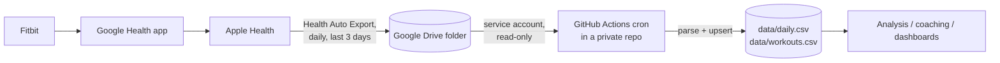

# health-pipeline

Incremental ETL that turns wearable data into one tidy row per day, on a schedule, with no server to run.



**Extract** new export files from a Drive folder (or a local inbox) → **transform** Health Auto Export JSON into a fixed daily schema with normalised units → **load** with keyed upserts into CSV, committed to a private repository.

## Why it is built this way

| Decision | Reason |
|---|---|
| Read from Apple Health, not the Fitbit cloud | The legacy Fitbit Web API was shut down on 2 Nov 2026. Its replacement, the Google Health API, classifies every health scope as *restricted*: production access needs a security review, and an unreviewed personal app's refresh tokens expire after 7 days, which breaks unattended jobs. The data already flows Fitbit → Google Health → Apple Health on the phone, so the pipeline taps the end of that chain. |
| Google Drive + **service account** as the hand-off | The phone app can write to Drive on a schedule. A service account reads the shared folder without user OAuth, so nothing expires and nobody has to sign in again. Scope is `drive.readonly`. |
| GitHub Actions as the scheduler | Free, managed cron with secrets storage and an audit trail. Each run is a commit, so the data has full history and diffs. |
| **Incremental** runs | `state/sync_state.json` records each source file's version (Drive `modifiedTime`, or a content hash for local files). Unchanged files are skipped, so a run downloads only what is new. |
| **Idempotent, column-level upserts** | Rows are keyed by `date` (workouts by `start`). A record only overwrites the columns it carries, so a late export that only revises sleep does not wipe that day's steps. Values are rounded before comparison, so re-running over the same input produces a byte-identical file and no commit. |
| Overlapping 3-day window | Sleep and HRV are often finalised hours after waking. Each export re-sends the last 3 days; the upsert picks up the revised values and leaves everything else untouched. |
| Code public, data private | This repo holds only code and synthetic fixtures. Real data lives in a separate private repo whose workflow installs this package. Logs print counts and dates, never metric values. |
| Tolerant parser | Health Auto Export's schema has changed between versions (sleep and workout field names). Known variants are mapped; unknown metrics are ignored instead of failing the run; one corrupt file does not block the rest. |

## Data model

`data/daily.csv`, one row per date:

| Group | Columns |
|---|---|
| Sleep (minutes, night ending on `date`) | `sleep_min`, `sleep_deep_min`, `sleep_rem_min`, `sleep_core_min`, `sleep_awake_min`, `in_bed_min`, `sleep_start`, `sleep_end` |
| Heart | `hrv_ms`, `resting_hr_bpm`, `hr_min_bpm`, `hr_avg_bpm`, `hr_max_bpm` |
| Recovery signals | `resp_rate_bpm`, `spo2_pct`, `wrist_temp_c` |
| Activity | `steps`, `active_kcal`, `basal_kcal`, `distance_km`, `exercise_min` |
| Body | `weight_kg`, `body_fat_pct` |

`data/workouts.csv`: `start`, `date`, `name`, `duration_min`, `distance_km`, `active_kcal`, `hr_avg_bpm`, `hr_max_bpm`.

Units are normalised on the way in: kJ → kcal, miles/metres → km, lb → kg, °F → °C, SpO₂ fractions → percent, hours → minutes.

## Setup

1. **Phone.** Install [Health Auto Export](https://apps.apple.com/app/id1115567069). Create an automation: destination Google Drive, data Health Metrics (+ a second one for Workouts), aggregation **daily**, range **last 3 days**, format **JSON**, schedule daily.
2. **Google Cloud.** Create a project, enable the **Google Drive API**, create a **service account**, and download a JSON key. Share the Drive export folder with the service account's e-mail as *Viewer*.
3. **Private data repo.** Copy [`examples/data-repo-sync.yml`](examples/data-repo-sync.yml) to `.github/workflows/sync.yml` and add two repository secrets: `GDRIVE_SA_KEY` (the whole JSON key) and `GDRIVE_FOLDER_ID` (the id at the end of the folder's URL).
4. Run the workflow once by hand (**Actions → sync → Run workflow**). After that it runs on its own.

Backfill: export a longer range by hand from the app and commit the file to the data repo's `inbox/`. The next run merges it.

## Local use

```bash
pip install -e ".[dev,drive]"
pytest -q
health-pipeline sync --inbox ./inbox --data-dir ./data --state ./state/sync_state.json
# with Drive
export GDRIVE_SA_KEY="$(cat key.json)" GDRIVE_FOLDER_ID=...
health-pipeline sync --data-dir ./data --state ./state/sync_state.json
```

## Layout

```
src/health_pipeline/
  parse_hae.py      Health Auto Export JSON -> {date: {column: value}}, workouts
  store.py          keyed CSV upserts with a change report
  sync.py           incremental run: sources -> parse -> store -> state
  sources/drive.py  Google Drive via service account (recursive, oldest first)
  sources/local.py  local inbox folder
  cli.py            `health-pipeline sync`
tests/              synthetic fixtures for both known export schemas
```

## License

MIT
